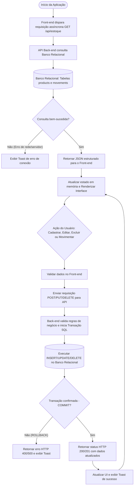

# Esboço de Correções e Melhorias — StockLab v1.4

Este documento apresenta o diagnóstico técnico baseado no código-fonte atual (`v1.4`), mapeando os bugs identificados, as sugestões de correção e a proposta de transição do armazenamento local para um banco de dados relacional.

## 1. Correção de Lógica de Negócio e Bugs

### 1.1. Valor Total em Estoque (Métrica Incorreta)

- **Onde está o erro:** Na função `render()`, especificamente na atualização do elemento `#metric-value`.
- **Problema:** O código está somando apenas o preço unitário de cada produto cadastrado (`sum + p.price`), ignorando a quantidade disponível em estoque de cada item.
- **Código atual:**

  ```javascript
  $("metric-value").textContent = money(
    data.products.reduce((sum, p) => sum + p.price, 0),
  );
  ```

- **Proposta de correção:** Multiplicar o preço unitário pela quantidade em estoque (`p.price * p.stock`) antes de acumular a soma.

  ```javascript
  $("metric-value").textContent = money(
    data.products.reduce((sum, p) => sum + p.price * p.stock, 0),
  );
  ```

### 1.2. Edição de Preço Ignorada

- **Onde está o erro:** Na função `saveProduct(event)`, dentro do bloco condicional `if (id)` responsável por atualizar um produto existente.
- **Problema:** A variável `price` é capturada e validada no início da função, mas não é atribuída ao objeto `p` durante a atualização. Apenas `name`, `sku`, `category` e `stock` são salvos.
- **Código atual:**

  ```javascript
  if (id) {
    const p = data.products.find((x) => x.id === id);
    if (p) {
      p.name = name;
      p.sku = sku;
      p.category = category;
      p.stock = stock;
    }
  }
  ```

- **Proposta de correção:** Incluir `p.price = price;` na atualização do objeto. (Também é recomendável validar se `price >= 0` na checagem inicial para evitar preços negativos).

  ```javascript
  if (id) {
    const p = data.products.find((x) => x.id === id);
    if (p) {
      p.name = name;
      p.sku = sku;
      p.category = category;
      p.price = price; // Correção aplicada
      p.stock = stock;
    }
  }
  ```

### 1.3. Avaliação de Limites de Estoque Baixo

- **Onde está o erro:** Espalhado em três pontos distintos:
  1. Na função `status(p)`: verifica `p.stock < 5`.
  2. Na função `render()` para `#metric-alerts`: filtra `p.stock < 5`.
  3. Na função `render()` para `#low-stock-list`: filtra `p.stock < 5`.
- **Problema:**
  - O limite está fixo (_hardcoded_) como `< 5` em vários lugares, dificultando a manutenção.
  - Itens zerados (`stock === 0`) estão sendo contabilizados na mesma métrica de alerta que itens com estoque baixo, o que pode gerar ambiguidade na leitura gerencial, além de não permitir configuração por produto ou global.
- **Proposta de correção:** Centralizar a regra em uma constante de configuração (ou propriedade por produto, caso evolua) e separar claramente os estados.

  ```javascript
  // No topo do escopo
  const LOW_STOCK_LIMIT = 5;

  // Na função status
  const status = (p) => {
    if (p.stock === 0) return ["Sem estoque", "zero"];
    if (p.stock < LOW_STOCK_LIMIT) return ["Estoque baixo", "low"];
    return ["Disponível", "good"];
  };
  ```

  _(Nota: Avaliar com a equipe se produtos com `stock === 0` devem continuar somando em `#metric-alerts` ou se deve haver um card separado para itens esgotados)._

### 1.4. Ponto de Atenção Extra: Saída de Estoque não Deduz Saldo

- **Onde está o erro:** Na função `saveMovement(event)`.
- **Problema:** O código valida se há saldo para saída (`if (type === 'saida' && quantity > p.stock)`), mas logo abaixo só executa a operação matemática para entrada (`if (type === 'entrada') p.stock += quantity;`), esquecendo de subtrair quando for saída.
- **Proposta de correção:**

  ```javascript
  if (type === "entrada") {
    p.stock += quantity;
  } else if (type === "saida") {
    p.stock -= quantity;
  }
  ```

## 2. Avaliação do Armazenamento de Dados (Migração para Banco Relacional)

### 2.1. Diagnóstico do Cenário Atual vs. Banco Relacional

- **Onde está acoplado no código atual:** Na leitura inicial (`localStorage.getItem(KEY)`), na função síncrona `persist()`, e na geração manual de IDs (`Math.max(...) + 1`) dentro de `saveProduct` e `saveMovement`.
- **Limitações do `localStorage` para o sistema:**
  - **Volatilidade e Isolamento:** Os dados ficam presos ao navegador/máquina local. Se o usuário limpar o cache ou trocar de computador, todo o histórico de estoque é perdido.
  - **Falta de Integridade Relacional:** Na estrutura atual, a movimentação salva apenas o nome do produto como texto (`product: p.name`). Se o nome do produto for editado posteriormente, o histórico perde a referência real ao item.
  - **Concorrência:** Não permite múltiplos usuários operando o estoque simultaneamente sem sobrescrever dados.
- **O que muda na arquitetura para Banco Relacional (ex: PostgreSQL, MySQL, SQLite):**
  1. **Camada de API (Back-end):** O front-end deixa de manipular o armazenamento diretamente e passa a fazer requisições assíncronas (`fetch` / `async-await`) para endpoints REST (ex: `GET /products`, `POST /movements`).
  2. **Modelagem Relacional:** Criação de tabelas normalizadas (`products` e `movements`) ligadas por Chave Estrangeira (`product_id`), garantindo integridade referencial.
  3. **Transações ACID:** O registro de uma movimentação e a atualização do saldo em estoque (`products.stock`) passam a ocorrer dentro de uma mesma transação no banco, evitando inconsistências caso ocorra falha no meio do processo.
  4. **Papel do Navegador (`localStorage`):** Fica restrito apenas a preferências de interface (ex: última aba aberta, filtros ativos) ou token de autenticação (JWT), e não mais como banco de dados principal.

### 2.2. Fluxograma da Nova Arquitetura (Front-end + API + Banco Relacional)


